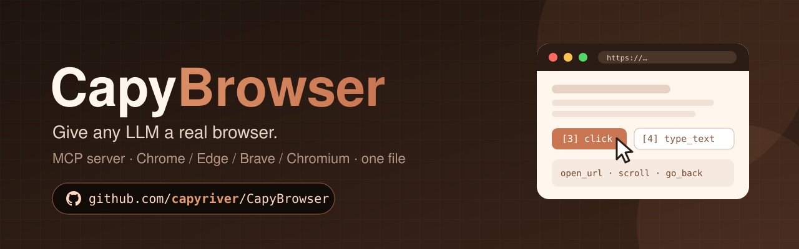
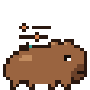
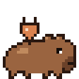
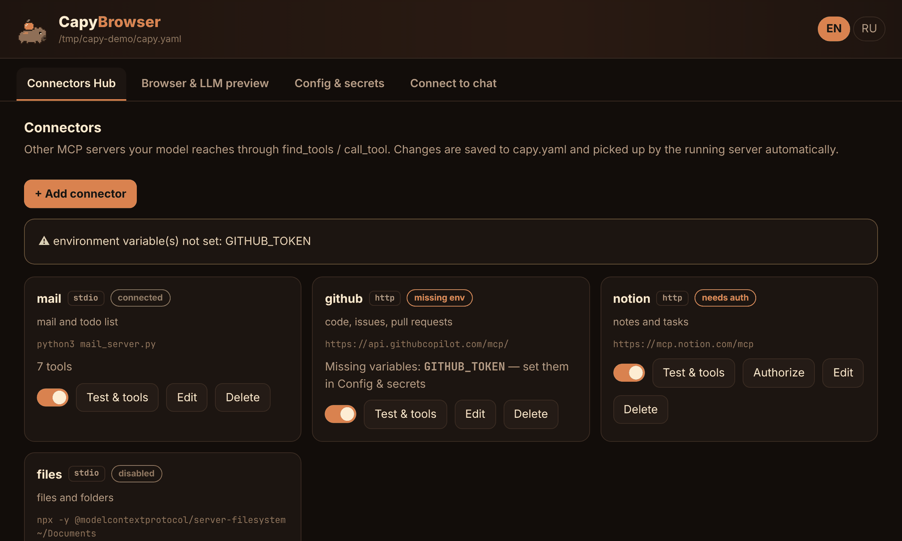
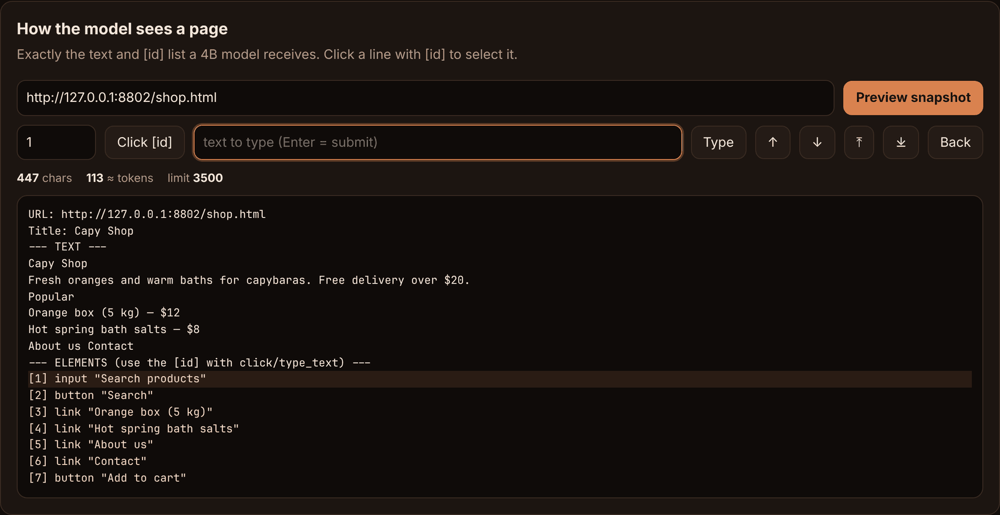
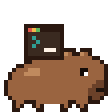

<p align="center">
  
</p>

<p align="center">
  A single-file MCP server that drives your system Chrome / Edge / Brave / Chromium over the DevTools Protocol.<br />
  No Playwright. No Selenium. No Puppeteer. One link to install.
</p>

<p align="center">
  <a href="#quick-start"> Quick start</a>
  &nbsp;·&nbsp;
  <a href="#control-panel"> Panel</a>
  &nbsp;·&nbsp;
  <a href="#capyyaml"> capy.yaml</a>
  &nbsp;·&nbsp;
  <a href="#connect-to-your-app"> Setup</a>
  &nbsp;·&nbsp;
  <a href="#faq"> FAQ</a>
  &nbsp;·&nbsp;
  <a href="https://capybrowser.pages.dev/"> Website</a>
  &nbsp;·&nbsp;
  <a href="https://github.com/capyriver"> CapyRiver</a>
  &nbsp;·&nbsp;
  <a href="https://t.me/CapyRiver"> Telegram</a>
</p>

<p align="center">
  
</p>

<p align="center">
   <a href="#en"><b>English</b></a> &nbsp;·&nbsp; <a href="#zh"><b>简体中文</b></a> &nbsp;·&nbsp; <a href="#ru"><b>Русский</b></a> &nbsp;·&nbsp; <a href="#kk"><b>Қазақша</b></a>
</p>

<p align="center">
  
  
  
  <a href="LICENSE"></a>
</p>

---

<a id="en"></a>

## English

###  What is it?

CapyBrowser is an [MCP](https://modelcontextprotocol.io) server. You plug it into an AI app (Claude Desktop, Claude Code, Cursor, VS Code, LM Studio, your own Ollama agent…) and the model gets a browser it can actually use: search the web, open pages, read them, click buttons, fill in forms, scroll and go back.

It was built for **small local models** first. Every page is compressed into a short, clean view — visible text plus a numbered list of clickable elements — capped at about 3,500 characters, so even a 4B model on a laptop can browse without drowning in HTML.

```text
URL: https://quotes.toscrape.com/login
Title: Quotes to Scrape
--- TEXT ---
Quotes to Scrape
Login
Username
Password
--- ELEMENTS (use the [id] with click/type_text) ---
[1] link "Quotes to Scrape"
[3] input "Username"
[4] input:password "password"
[5] button "Login"
```

The model answers with `type_text(3, "admin")`, `click(5)` — and a real browser does it.

###  Why CapyBrowser

| | CapyBrowser | Typical browser MCP servers |
|---|---|---|
| Install | one link, `uvx` downloads everything | Node + Playwright + ~300 MB of bundled browsers |
| Browser | the Chrome / Edge / Brave / Chromium you already have | a separate downloaded Chromium |
| Code | one Python file, four small dependencies (`mcp`, `websockets`, `pyyaml`, `httpx`) | large frameworks |
| Output for the model | compact text + `[id]` list, hard size limit | raw accessibility trees or screenshots, often 10–50k tokens |
| Small local models | designed and tested with a 4B model | usually need a large cloud model |

###  Features

- **6 browser tools:** `web_search`, `open_url`, `click`, `type_text`, `scroll`, `go_back` — plus 3 router tools (`list_connectors`, `find_tools`, `call_tool`) for every other MCP server you add in [capy.yaml](#capyyaml).
- **Control panel:** `capybrowser ui` — a local, offline web panel to add connectors from templates, test their tools, manage secrets, preview what the model sees and copy configs for your chat app ([details](#control-panel)).
- **Finds your browser automatically** on Windows, macOS and Linux (Chrome, Edge, Brave, Chromium, Vivaldi; stable, beta, dev, Canary, Snap, Flatpak).
- **Lazy start:** the browser launches on the first tool call, on a free port, with a fresh temporary profile. Your normal profile, passwords and cookies are never touched.
- **Works on modern sites:** real mouse and keyboard events through CDP, with verified fallbacks for React/Vue inputs, input masks (phones, cards, dates), overlays, custom checkboxes, shadow DOM, scroll containers and infinite feeds.
- **Handles the messy web:** `target=_blank` and `window.open` popups, `alert` / `confirm` / `beforeunload` dialogs, redirects, 404/500 pages, DNS errors, hanging servers and pages stuck in endless JavaScript loops.
- **Self-healing:** if the browser crashes or hangs, it is restarted and the last page is reopened.
- **Leaves nothing behind:** the browser process tree and its temporary profile are removed on exit, Ctrl+C and `SIGTERM`; leftovers from a hard kill are cleaned up on the next start.
- **Safe defaults:** DevTools listens on `127.0.0.1` only; `file://`, `javascript:` and `chrome://` URLs are refused (`file://` can be enabled explicitly).

<a id="quick-start"></a>

###  Quick start

**1. Install `uv`** (a fast Python package manager; it also installs Python for you):

```powershell
# Windows (PowerShell)
powershell -ExecutionPolicy ByPass -c "irm https://astral.sh/uv/install.ps1 | iex"
```

```bash
# macOS / Linux
curl -LsSf https://astral.sh/uv/install.sh | sh
```

**2. Have Chrome, Edge, Brave or Chromium installed.** Windows already ships with Edge, so on Windows there is nothing to do.

**3. Add CapyBrowser to your AI app.** This is the whole server — a single link:

```json
{
  "mcpServers": {
    "capybrowser": {
      "command": "uvx",
      "args": ["--from", "git+https://github.com/capyriver/CapyBrowser", "capybrowser"]
    }
  }
}
```

Restart the app and ask: *"Search the web for the latest Python release and open the official page."*

<a id="control-panel"></a>

###  Control panel: `capybrowser ui`

A local web panel for everything in `capy.yaml` — no YAML editing needed. It runs on your computer only, works fully offline and is built into the same single file.

```bash
uvx --from git+https://github.com/capyriver/CapyBrowser capybrowser ui     # or: uv run browser_mcp.py ui
capybrowser ui --config ~/.capy.yaml --port 8765 --no-open
```

<p align="center">
  
  
</p>

- **Connectors** — cards with live status (`ready`, `connected`, `needs auth`, `missing env`, `disabled`, `error`), an on/off switch, **Test & tools** (connect, see every tool with its arguments and run it with JSON arguments), **Authorize** for OAuth servers, **Edit** and **Delete**. **+ Add connector** offers templates: any remote MCP server (URL + OAuth / Bearer — Gmail / Google Workspace, Zapier, Composio, Cloudflare…), GitHub, Notion, Filesystem, PostgreSQL, SQLite, custom stdio and custom http/sse.
- **Browser & LLM preview** — all browser options (headed, language, `max_chars` with 4B / 8B / 32B presets, page timeout, profile folder, browser path) and a sandbox that shows **exactly what the model receives** for any URL or search, with character and token counts; click, type, scroll and go back right from the panel.
- **Config & secrets** — every `${VAR}` used in `capy.yaml` with its status; values you enter are written to `.env` next to the config (mode 600, added to `.gitignore`) and are never sent back to the page. A `capy.yaml` editor with **Validate** and **Save** that refuses a broken file.
- **Connect to chat** — copy-ready configs with absolute paths for LM Studio, Claude Desktop, Codex CLI, Cursor, Open WebUI (via mcpo) and the Python Ollama agent.

Every change is saved to `capy.yaml` (comments are kept) and a running CapyBrowser picks it up automatically. Options: `--config PATH` (default `./capy.yaml`, then `~/.capy.yaml`; a commented template is created if none exists), `--host` (default `127.0.0.1`), `--port` (default `8765`; a free port is used if it is busy), `--no-open`. Stop with Ctrl+C.

**Security.** The panel listens on `127.0.0.1` only. The link printed in the terminal contains a one-time session key; the page and every API call require it (`X-Capy-Token`), and requests with a foreign `Origin` or `Host` are rejected, so websites open in your browser cannot reach the panel (CSRF / DNS rebinding). A strict Content-Security-Policy is set and all data is rendered as text.

<a id="capyyaml"></a>

###  capy.yaml — one file: browser + all your MCP servers

`capy.yaml` is CapyBrowser's config file: browser settings plus **any other MCP servers** ("connectors"). Your AI app starts only CapyBrowser, and the model gets a small, fixed set of tools: the 6 browser tools and 3 router tools that reach every connector. Fifty connector tools do not have to be squeezed into a small model's context.

```yaml
browser:
  lang: en-US
  max_chars: 3500
  # profile_dir: ~/.capybrowser/profile
mcp_servers:
  time:
    command: uvx
    args: ["mcp-server-time"]
  files:
    command: npx
    args: ["-y", "@modelcontextprotocol/server-filesystem", "/path/to/folder"]
  github:
    type: streamable-http
    url: https://api.githubcopilot.com/mcp/
    auth:
      type: bearer
      token: ${GITHUB_TOKEN}
  notion:
    type: streamable-http
    url: https://mcp.notion.com/mcp
    auth:
      type: oauth
```

```text
list_connectors()                                   -> time, files, github, notion + status
find_tools("create an issue")                       -> github.create_issue(owner: string, repo: string, title: string, body?: string) — …
call_tool("github.create_issue", {"owner": "me", "repo": "app", "title": "Bug"})
```

**1. Create the file** (or copy [`capy.yaml`](capy.yaml) from this repository):

```bash
uvx --from git+https://github.com/capyriver/CapyBrowser capybrowser init ~/.capy.yaml
uvx --from git+https://github.com/capyriver/CapyBrowser capybrowser check --connect   # validate and test the connectors
```

**2. Point your app to it.** Add `--config` and the path to the `args`. If the file is `~/.capy.yaml` (or `./capy.yaml`), it is found automatically and this step can be skipped.

```json
{
  "mcpServers": {
    "capybrowser": {
      "command": "uvx",
      "args": ["--from", "git+https://github.com/capyriver/CapyBrowser", "capybrowser",
               "--config", "/path/to/capy.yaml"]
    }
  }
}
```

**3. Restart the app once.** Later edits of `capy.yaml` are picked up automatically — no restart needed.

| Router tool | What it does |
|---|---|
| `list_connectors` | Lists the connectors from `capy.yaml` and their status. |
| `find_tools(query, connector?, limit?)` | Finds connector tools by meaning, in English or Russian ("email" = "почта", "задачи" = "tasks/notion", "код" = "github"…). Returns compact signatures such as `github.create_issue(repo: string, title: string, body?: string)`. |
| `call_tool(tool, arguments)` | Runs `connector.tool`. `arguments` may be an object or a JSON string. Connects on first use, reconnects once if the server crashed, masks tokens in the answer and keeps it within `max_chars`. |

**Connectors**

- **Local (stdio):** `command`, `args`, `env`, `cwd` — the same format as `claude_desktop_config.json`.
- **Remote:** `type: streamable-http` (or `sse`), `url`, optional `headers`.
- **Auth:** `auth: {type: bearer, token: ${TOKEN}}`, or `auth: {type: oauth}` for OAuth 2.0 + PKCE: on first use your browser opens the provider's sign-in page; tokens are stored in `~/.capybrowser/oauth/` (file mode 600) and refreshed automatically. Optional: `client_id`, `client_secret`, `scopes`, `redirect_port` (default 33418).
- **Also:** `description` (helps `find_tools`), `enabled: false`, `timeout` (seconds, default 120).

**Secrets.** Write `${VAR}` instead of tokens. Values come from the environment or from a `.env` file next to `capy.yaml` (`KEY=value` lines; another name can be set with `env_file:`). `.env` is in `.gitignore`. Configured secrets and common token formats are masked in every connector answer and in the logs.

**Good to know**

- Lookup order: `--config`, `CAPYBROWSER_CONFIG`, `./capy.yaml`, `~/.capy.yaml`. Without a file, CapyBrowser runs the browser only.
- `browser` options: `headed`, `browser` (path), `lang`, `max_chars`, `nav_timeout`, `profile_dir`, `allow_local_files`. Command-line flags win over the file. Browser launch options apply from the next page opened.
- A broken edit does not break a running server: the last valid config stays active and `list_connectors` shows the error.
- Typos are not silently ignored: unknown sections or options, wrong types and invalid YAML are reported with the exact field.
- A connector that fails to start is reported by `list_connectors`; the browser and the other connectors keep working.
- All connector processes are stopped together with CapyBrowser (exit, Ctrl+C, `SIGTERM`, `SIGHUP`, `SIGBREAK`).

<a id="connect-to-your-app"></a>

###  Connect to your app

<details open>
<summary><b>Claude Desktop</b></summary>

Settings → Developer → Edit Config, or open the file directly:

- Windows: `%APPDATA%\Claude\claude_desktop_config.json`
- macOS: `~/Library/Application Support/Claude/claude_desktop_config.json`

Paste the JSON from the quick start (merge it into an existing `mcpServers` block if there is one) and restart Claude Desktop.
</details>

<details>
<summary><b>Claude Code</b></summary>

```bash
claude mcp add capybrowser -- uvx --from git+https://github.com/capyriver/CapyBrowser capybrowser
# available in every project:
claude mcp add -s user capybrowser -- uvx --from git+https://github.com/capyriver/CapyBrowser capybrowser
```
</details>

<details>
<summary><b>Cursor</b></summary>

Put the quick-start JSON into `~/.cursor/mcp.json` (all projects) or `.cursor/mcp.json` (one project). Example: [`examples/cursor_mcp.json`](examples/cursor_mcp.json).
</details>

<details>
<summary><b>VS Code (GitHub Copilot agent mode)</b></summary>

Create `.vscode/mcp.json` — note the key is `servers`, not `mcpServers`:

```json
{
  "servers": {
    "capybrowser": {
      "type": "stdio",
      "command": "uvx",
      "args": ["--from", "git+https://github.com/capyriver/CapyBrowser", "capybrowser"]
    }
  }
}
```
</details>

<details>
<summary><b>LM Studio · Windsurf · Gemini CLI · other MCP clients</b></summary>

All of them use the same `mcpServers` JSON from the quick start:

- LM Studio: Program tab → Install → Edit `mcp.json`
- Windsurf: `~/.codeium/windsurf/mcp_config.json`
- Gemini CLI: `~/.gemini/settings.json`

Any client that can start a **stdio** MCP server works.
</details>

<details>
<summary><b>OpenAI Codex CLI</b></summary>

`~/.codex/config.toml`:

```toml
[mcp_servers.capybrowser]
command = "uvx"
args = ["--from", "git+https://github.com/capyriver/CapyBrowser", "capybrowser"]
```
</details>

<details>
<summary><b>Ollama and other local models</b></summary>

Ollama itself does not speak MCP, so the repository includes a ready-made agent, [`examples/ollama_agent.py`](examples/ollama_agent.py), that connects any Ollama model with tool calling to CapyBrowser:

```bash
ollama pull qwen3:4b-instruct
uv run https://raw.githubusercontent.com/capyriver/CapyBrowser/main/examples/ollama_agent.py "Open https://news.ycombinator.com and tell me the top story"
```

Set `OLLAMA_MODEL` to use another model (Qwen 3, Llama 3.1+, Mistral, Gemma 3 and other models with tool support).
</details>

###  Other ways to install

```bash
# Run without installing (always the latest version from GitHub)
uvx --from git+https://github.com/capyriver/CapyBrowser capybrowser

# Install the `capybrowser` command permanently
uv tool install git+https://github.com/capyriver/CapyBrowser
pipx install git+https://github.com/capyriver/CapyBrowser
pip install git+https://github.com/capyriver/CapyBrowser

# It is a single file: run it straight from the URL or from a download
uv run https://raw.githubusercontent.com/capyriver/CapyBrowser/main/browser_mcp.py
uv run browser_mcp.py
```

After `uv tool install`, the MCP config can simply be `"command": "capybrowser"` with no arguments. Update with `uv tool upgrade capybrowser`.

###  Tools

| Tool | Arguments | What it does |
|---|---|---|
| `web_search` | `query` | Searches the web (DuckDuckGo, Bing as fallback) and returns up to 10 results: `[id]` title, URL, snippet. |
| `open_url` | `url` | Opens a page and returns its compact view. `example.com` works without `https://`. |
| `click` | `element_id` | Clicks the element with that `[id]` (link, button, checkbox, tab, card…). |
| `type_text` | `element_id`, `text`, `submit=false` | Replaces the text of an input / textarea / editable area. For a `<select>`, picks the option by its text. `submit=true` presses Enter. |
| `scroll` | `direction` | `down`, `up`, `top` or `bottom`. Scrolls the page or the main scroll container. |
| `go_back` | — | Goes back in the browser history. |
| `list_connectors` · `find_tools` · `call_tool` | see [capy.yaml](#capyyaml) | Reach the other MCP servers configured in `capy.yaml`. |

Every tool returns the updated page, so the model always sees the result of its action. IDs are renumbered after every action, and errors come back as plain-text messages the model can recover from (for example *"element [12] not found — use an id from this list"* followed by the current page).

###  Options

| Flag | Environment variable | Default | Meaning |
|---|---|---|---|
| `--config PATH` | `CAPYBROWSER_CONFIG` | `./capy.yaml`, `~/.capy.yaml` | Config file with browser settings and extra MCP servers, see [capy.yaml](#capyyaml). |
| `--headed` | — | off | Show the browser window (useful to watch or debug the agent). |
| `--browser PATH` | `BROWSER_MCP_PATH` | auto | Use a specific browser executable. |
| `--max-chars N` | `BROWSER_MCP_MAX_CHARS` | `3500` | Maximum size of every tool response. Raise it for large-context models. |
| `--lang ru-RU` | `BROWSER_MCP_LANG` | system locale | Browser UI language and `Accept-Language`. |
| `--profile-dir PATH` | — | temporary | Keep cookies and logins in this folder between runs (`profile_dir` in capy.yaml). |
| `--allow-local-files` | `BROWSER_MCP_ALLOW_FILE=1` | off | Allow `open_url` with `file://` URLs. |
| — | `BROWSER_MCP_NAV_TIMEOUT` | `25` | Seconds to wait for a page to load. |
| `--log-level` | `BROWSER_MCP_LOG` | `WARNING` | Log level (logs go to stderr). |

Example with options: [`examples/advanced_config.json`](examples/advanced_config.json).

###  How it works

1. The MCP client starts `capybrowser` and talks to it over stdio.
2. On the first tool call, CapyBrowser finds your browser and starts it with `--remote-debugging-port` on a free local port and a temporary `--user-data-dir` (headless by default; `--no-sandbox` is added automatically for root/containers on Linux).
3. It connects to the page over the Chrome DevTools Protocol (a WebSocket) and drives it with `Page.*`, `Runtime.evaluate` and `Input.*` commands.
4. A small script inside the page marks the visible clickable elements with `data-mcp-id` and extracts the readable text from the current scroll position; the result is trimmed to the size limit.
5. On exit the whole browser process tree is killed and the temporary profile is deleted.

###  Security

- The model gets a **separate browser with an empty profile**: no access to your usual cookies, logins, passwords or extensions.
- DevTools is bound to `127.0.0.1`; nothing is exposed to the network.
- Web pages may contain text written to manipulate AI agents (prompt injection). Do not let an agent act on bank, email or work accounts unattended.
- More details: [SECURITY.md](SECURITY.md).

<a id="faq"></a>

###  FAQ

<details>
<summary><b>Why do I need this? My chatbot can already search the web.</b></summary>

Built-in search returns snippets. CapyBrowser gives the model a real browser: it can open any page, read the full content, log in to a test account, fill and submit forms, click through a multi-step site, read pages rendered by JavaScript — and it works with **local models** that have no internet access at all.
</details>

<details>
<summary><b>Does it work with local models? Which one should I use?</b></summary>

Yes, that is the main goal. It is tested end-to-end with **Qwen 3 4B Instruct** in Ollama on CPU: web search, multi-page navigation, logging in, filling forms, scrolling long articles, going back, handling 404 and DNS errors. Any model with reliable tool calling works; bigger models (Qwen 3 8B/14B, Llama 3.1 8B+, Mistral Small) are more robust on complex tasks.
</details>

<details>
<summary><b>Do I need to install Python, Node.js or Playwright?</b></summary>

No Node.js and no Playwright. `uv` downloads a suitable Python and its small Python dependencies automatically on the first run. You only need `uv` and a Chromium-based browser.
</details>

<details>
<summary><b>Which browsers are supported? What about Firefox and Safari?</b></summary>

Google Chrome, Microsoft Edge, Brave, Chromium and Vivaldi (including beta/dev/Canary builds, Snap and Flatpak). Firefox and Safari are not supported: CapyBrowser speaks the Chrome DevTools Protocol. If you have several browsers, choose one with `--browser`.
</details>

<details>
<summary><b>Will it use or break my normal browser profile?</b></summary>

No. By default every session uses a fresh temporary profile in the system temp folder, deleted on exit. If you want logins to persist, set `profile_dir` in capy.yaml (or `--profile-dir`) to a separate folder — never to your everyday browser profile. Your running browser is not affected — both can run at the same time.
</details>

<details>
<summary><b>Can I watch what the AI is doing?</b></summary>

Yes: add `--headed` to the `args` and a normal browser window opens. On Linux this requires a desktop session (`DISPLAY`/`WAYLAND_DISPLAY`); without one CapyBrowser falls back to headless mode.
</details>

<details>
<summary><b>Can the model log in to sites?</b></summary>

It can type into login forms like a person would, which is handy for test accounts. Sessions do not persist between runs unless you set `profile_dir` (by default the profile is temporary). Think twice before giving an AI real credentials.
</details>

<details>
<summary><b>Does it solve CAPTCHAs or bypass bot protection?</b></summary>

No. CapyBrowser removes the obvious `HeadlessChrome` marker from the user agent, but it is not a stealth or anti-bot tool. If a search engine shows a CAPTCHA, `web_search` falls back to another engine and otherwise reports the problem.
</details>

<details>
<summary><b>Does it send any data anywhere?</b></summary>

Only to the websites the model opens, and to DuckDuckGo/Bing for `web_search`. There is no telemetry, no account and no API key.
</details>

<details>
<summary><b>Can it take screenshots, download files or work with several tabs?</b></summary>

Not in this version, on purpose: the tool set is kept small so that small models use it reliably. Links that open a new tab are opened in the same tab, downloads are blocked, and JavaScript dialogs are accepted automatically.
</details>

<details>
<summary><b>Pages are cut off. Can the model see more?</b></summary>

The model can call `scroll` to read further; every page view says how much of the page has been seen. With a large-context model you can raise the limit with `--max-chars 8000`.
</details>

<details>
<summary><b>How do I update?</b></summary>

With `uvx --from git+…` you get the latest version on every start (uv caches it; `uv cache clean` forces a refresh). With `uv tool install`, run `uv tool upgrade capybrowser`.
</details>

###  Troubleshooting

| Problem | Fix |
|---|---|
| `No Chrome/Edge/Brave/Chromium found` | Install one of them, or pass the path: `--browser "C:\Program Files\Google\Chrome\Application\chrome.exe"`. |
| The app says the MCP server failed to start / `uvx` not found | GUI apps do not always see your new `PATH`. Restart the computer, or use the full path to `uvx`: Windows `C:\Users\<you>\.local\bin\uvx.exe`, macOS/Linux `~/.local/bin/uvx`. |
| Browser fails to start in Docker / as root on Linux | Handled automatically (`--no-sandbox`, `--disable-dev-shm-usage`). If it still fails, install the browser's system dependencies (e.g. `apt-get install chromium`). |
| Corporate proxy | The browser uses the system proxy settings; on Linux it also reads `HTTPS_PROXY`. |
| Pages load slowly | Raise `BROWSER_MCP_NAV_TIMEOUT` (seconds). |
| You want to see logs | Add `--log-level INFO`; logs go to stderr (in Claude Desktop: Settings → Developer → Open Logs Folder). |

###  Development

```bash
git clone https://github.com/capyriver/CapyBrowser
cd CapyBrowser
uv run --extra dev pytest -q      # unit + real-browser + MCP protocol tests
uv run --extra dev ruff check .
uv run capybrowser --headed       # run from source
```

Project layout:

```text
browser_mcp.py          the whole server and the `ui` control panel (also runnable as a single PEP 723 script)
capy.yaml               example config: browser settings + connectors (other MCP servers)
uv.lock                 locked dependency versions
pyproject.toml          package metadata and the `capybrowser` command
examples/               MCP configs for popular apps and an Ollama agent
tests/                  pytest suite (runs on Windows, macOS and Linux in CI)
assets/                 banner, tagline, footer, pixel-art capybara icons, panel screenshots, social preview image
site/                   website capybrowser.pages.dev (static, deployed to Cloudflare Pages by .github/workflows/pages.yml)
```

Before the first release the server went through more than 40,000 automated checks: fuzzing on thousands of generated and broken HTML pages, connect/disconnect and crash/kill cycles with leak and zombie-process checks, invalid arguments over the real MCP protocol, and end-to-end runs where a 4B local model completed real tasks on live websites.

###  License

MIT — see [LICENSE](LICENSE). Not affiliated with Google, Microsoft, Brave or Anthropic.

---

<a id="zh"></a>

## 简体中文

###  这是什么？

CapyBrowser 是一个 [MCP](https://modelcontextprotocol.io) 服务器。把它接入 AI 应用（Claude Desktop、Claude Code、Cursor、VS Code、LM Studio、你自己的 Ollama 智能体……），模型就能真正使用浏览器：搜索网页、打开页面、阅读内容、点击按钮、填写表单、滚动和后退。

它首先是为**小型本地模型**设计的。每个页面都会被压缩成简短清晰的视图——可见文本加上带编号的可点击元素列表——长度约 3500 个字符以内，因此即使是笔记本上的 4B 模型也能浏览网页而不会被 HTML 淹没。

```text
URL: https://quotes.toscrape.com/login
--- TEXT ---
Login
Username
Password
--- ELEMENTS (use the [id] with click/type_text) ---
[3] input "Username"
[4] input:password "password"
[5] button "Login"
```

模型只需回复 `type_text(3, "admin")`、`click(5)`，真实的浏览器就会执行。

###  为什么选择 CapyBrowser

| | CapyBrowser | 常见的浏览器 MCP 服务器 |
|---|---|---|
| 安装 | 一个链接，`uvx` 自动下载一切 | Node + Playwright + 约 300 MB 的捆绑浏览器 |
| 浏览器 | 使用你已安装的 Chrome / Edge / Brave / Chromium | 单独下载的 Chromium |
| 代码 | 一个 Python 文件，四个轻量依赖（`mcp`、`websockets`、`pyyaml`、`httpx`） | 大型框架 |
| 给模型的输出 | 精简文本 + `[id]` 列表，严格长度限制 | 原始无障碍树或截图，常常 1–5 万 token |
| 小型本地模型 | 专门设计并用 4B 模型测试 | 通常需要大型云端模型 |

###  功能

- **6 个浏览器工具：** `web_search`、`open_url`、`click`、`type_text`、`scroll`、`go_back`，以及用于 capy.yaml 中所有其他 MCP 服务器的 3 个路由工具（`list_connectors`、`find_tools`、`call_tool`）。
- **控制面板：** `capybrowser ui` —— 本地离线网页面板，可用模板添加连接器、测试工具、管理密钥、预览模型看到的内容并复制聊天应用配置。
- **自动查找浏览器**：支持 Windows、macOS、Linux（Chrome、Edge、Brave、Chromium、Vivaldi；稳定版、Beta、Dev、Canary、Snap、Flatpak）。
- **按需启动**：首次调用工具时才启动浏览器，使用空闲端口和全新的临时配置文件，绝不触碰你平时的配置、密码和 Cookie。
- **适配现代网站**：通过 CDP 发送真实的鼠标和键盘事件，并为 React/Vue 输入框、输入掩码（电话、银行卡、日期）、遮罩层、自定义复选框、Shadow DOM、滚动容器和无限加载列表提供经过验证的后备方案。
- **应对复杂网页**：`target=_blank` 和 `window.open` 弹窗、`alert` / `confirm` / `beforeunload` 对话框、重定向、404/500 页面、DNS 错误、无响应的服务器以及卡死在无限 JavaScript 循环中的页面。
- **自动恢复**：浏览器崩溃或卡死时自动重启并重新打开上一个页面。
- **不留痕迹**：退出、Ctrl+C 和 `SIGTERM` 时会结束整个浏览器进程树并删除临时配置；被强制结束后残留的文件会在下次启动时清理。
- **安全默认值**：DevTools 只监听 `127.0.0.1`；拒绝 `file://`、`javascript:`、`chrome://` 链接（`file://` 可以显式开启）。

###  快速开始

**1. 安装 `uv`**（快速的 Python 包管理器，也会自动为你安装 Python）：

```powershell
# Windows (PowerShell)
powershell -ExecutionPolicy ByPass -c "irm https://astral.sh/uv/install.ps1 | iex"
```

```bash
# macOS / Linux
curl -LsSf https://astral.sh/uv/install.sh | sh
```

**2. 安装 Chrome、Edge、Brave 或 Chromium 之一。** Windows 自带 Edge，无需额外操作。

**3. 把 CapyBrowser 添加到 AI 应用。** 整个服务器就是一个链接：

```json
{
  "mcpServers": {
    "capybrowser": {
      "command": "uvx",
      "args": ["--from", "git+https://github.com/capyriver/CapyBrowser", "capybrowser"]
    }
  }
}
```

重启应用后试着问：*“搜索 Python 的最新版本并打开官方页面。”*

###  控制面板：`capybrowser ui`

用于管理 `capy.yaml` 全部内容的本地网页面板，无需手动编辑 YAML。它只在你的电脑上运行，完全离线可用，并且内置在同一个文件中。

```bash
uvx --from git+https://github.com/capyriver/CapyBrowser capybrowser ui     # or: uv run browser_mcp.py ui
capybrowser ui --config ~/.capy.yaml --port 8765 --no-open
```

<p align="center">
  
  
</p>

- **连接器**：显示实时状态（`ready`、`connected`、`needs auth`、`missing env`、`disabled`、`error`）的卡片，开关、**Test & tools**（连接后查看所有工具及参数，并用 JSON 参数直接运行）、OAuth 服务器的 **Authorize**、**Edit** 和 **Delete**。**+ Add connector** 提供模板：任意远程 MCP 服务器（URL + OAuth / Bearer：Gmail / Google Workspace、Zapier、Composio、Cloudflare 等）、GitHub、Notion、Filesystem、PostgreSQL、SQLite、自定义 stdio 和 http/sse。
- **浏览器与 LLM 预览**：所有浏览器选项（窗口、语言、带 4B / 8B / 32B 预设的 `max_chars`、加载超时、配置文件夹、浏览器路径），以及一个沙盒，可显示任意网址或搜索下**模型实际收到的内容**及字符数和 token 数；可直接在面板中点击、输入、滚动和后退。
- **配置与密钥**：列出 `capy.yaml` 中使用的所有 `${VAR}` 及状态；输入的值写入配置旁的 `.env`（权限 600，并加入 `.gitignore`），且永远不会返回到页面。带 **Validate** 和 **Save** 的 `capy.yaml` 编辑器，拒绝保存无效文件。
- **连接到聊天**：为 LM Studio、Claude Desktop、Codex CLI、Cursor、Open WebUI（通过 mcpo）和 Python Ollama 智能体提供带绝对路径、可一键复制的配置。

所有修改都会保存到 `capy.yaml`（保留注释），正在运行的 CapyBrowser 会自动加载。参数：`--config PATH`（默认 `./capy.yaml`，其次 `~/.capy.yaml`；都不存在时会创建带注释的模板）、`--host`（默认 `127.0.0.1`）、`--port`（默认 `8765`，被占用时自动换用空闲端口）、`--no-open`。按 Ctrl+C 停止。

**安全。** 面板只监听 `127.0.0.1`。终端中打印的链接包含一次性会话密钥；页面和所有 API 调用都需要它（`X-Capy-Token`），来自其他 `Origin` 或 `Host` 的请求会被拒绝，因此浏览器中打开的网站无法访问面板（CSRF / DNS 重绑定）。页面启用严格的 Content-Security-Policy，所有数据都以纯文本显示。

###  capy.yaml —— 一个文件：浏览器 + 你所有的 MCP 服务器

`capy.yaml` 是 CapyBrowser 的配置文件：浏览器设置以及**任意其他 MCP 服务器**（"连接器"）。你的 AI 应用只需启动 CapyBrowser，模型得到的是一组固定且精简的工具：6 个浏览器工具和 3 个路由工具，通过它们可以使用所有连接器。几十个连接器工具不必全部塞进小模型的上下文。

```yaml
browser:
  lang: zh-CN
  max_chars: 3500
  # profile_dir: ~/.capybrowser/profile
mcp_servers:
  time:
    command: uvx
    args: ["mcp-server-time"]
  files:
    command: npx
    args: ["-y", "@modelcontextprotocol/server-filesystem", "/path/to/folder"]
  github:
    type: streamable-http
    url: https://api.githubcopilot.com/mcp/
    auth:
      type: bearer
      token: ${GITHUB_TOKEN}
  notion:
    type: streamable-http
    url: https://mcp.notion.com/mcp
    auth:
      type: oauth
```

```text
list_connectors()                                   -> time, files, github, notion + status
find_tools("create an issue")                       -> github.create_issue(owner: string, repo: string, title: string, body?: string) — …
call_tool("github.create_issue", {"owner": "me", "repo": "app", "title": "Bug"})
```

**1. 创建文件**（或复制本仓库中的 [`capy.yaml`](capy.yaml)）：

```bash
uvx --from git+https://github.com/capyriver/CapyBrowser capybrowser init ~/.capy.yaml
uvx --from git+https://github.com/capyriver/CapyBrowser capybrowser check --connect   # validate and test the connectors
```

**2. 让应用使用它。** 在 `args` 中加入 `--config` 和文件路径。如果文件是 `~/.capy.yaml`（或 `./capy.yaml`），会被自动找到，可以跳过此步。

```json
{
  "mcpServers": {
    "capybrowser": {
      "command": "uvx",
      "args": ["--from", "git+https://github.com/capyriver/CapyBrowser", "capybrowser",
               "--config", "/path/to/capy.yaml"]
    }
  }
}
```

**3. 重启一次应用。** 之后对 `capy.yaml` 的修改会被自动加载，无需重启。

| 路由工具 | 作用 |
|---|---|
| `list_connectors` | 列出 `capy.yaml` 中的连接器及其状态。 |
| `find_tools(query, connector?, limit?)` | 按含义查找连接器工具，支持英文和俄文（如 email/почта、tasks/задачи、github/код）。返回精简签名，例如 `github.create_issue(repo: string, title: string, body?: string)`。 |
| `call_tool(tool, arguments)` | 运行 `连接器.工具`。`arguments` 可以是对象或 JSON 字符串。首次使用时连接，服务器崩溃时自动重连一次，屏蔽回答中的令牌，并保证不超过 `max_chars`。 |

**连接器**

- **本地（stdio）：** `command`、`args`、`env`、`cwd`，格式与 `claude_desktop_config.json` 相同。
- **远程：** `type: streamable-http`（或 `sse`）、`url`，可选 `headers`。
- **认证：** `auth: {type: bearer, token: ${TOKEN}}`，或 `auth: {type: oauth}`（OAuth 2.0 + PKCE）：首次使用时会在浏览器中打开登录页，令牌保存在 `~/.capybrowser/oauth/`（权限 600）并自动刷新。可选：`client_id`、`client_secret`、`scopes`、`redirect_port`（默认 33418）。
- **其他：** `description`（帮助 `find_tools`）、`enabled: false`、`timeout`（秒，默认 120）。

**密钥。** 用 `${VAR}` 代替令牌。取值来自环境变量或 `capy.yaml` 旁边的 `.env` 文件（`KEY=value`；可用 `env_file:` 指定其他文件名）。`.env` 已在 `.gitignore` 中。配置中的密钥和常见令牌格式会在所有连接器回答和日志中被屏蔽。

**须知**

- 查找顺序：`--config`、`CAPYBROWSER_CONFIG`、`./capy.yaml`、`~/.capy.yaml`。没有文件时只运行浏览器。
- `browser` 选项：`headed`、`browser`（路径）、`lang`、`max_chars`、`nav_timeout`、`profile_dir`、`allow_local_files`。命令行参数优先。浏览器启动选项从下一次打开页面时生效。
- 错误的修改不会影响正在运行的服务器：继续使用上一个有效配置，`list_connectors` 会显示错误。
- 拼写错误不会被忽略：未知的分区或选项、错误的类型和无效的 YAML 都会准确指出字段。
- 无法启动的连接器会在 `list_connectors` 中显示，浏览器和其他连接器照常工作。
- 所有连接器进程都会随 CapyBrowser 一起结束（退出、Ctrl+C、`SIGTERM`、`SIGHUP`、`SIGBREAK`）。

###  接入应用

- **Claude Desktop：** 设置 → 开发者 → 编辑配置，或直接打开 `%APPDATA%\Claude\claude_desktop_config.json`（Windows）/ `~/Library/Application Support/Claude/claude_desktop_config.json`（macOS），粘贴上面的 JSON 并重启。
- **Claude Code：** `claude mcp add capybrowser -- uvx --from git+https://github.com/capyriver/CapyBrowser capybrowser`（加 `-s user` 可用于所有项目）。
- **Cursor：** `~/.cursor/mcp.json` 或 `.cursor/mcp.json`，示例见 [`examples/cursor_mcp.json`](examples/cursor_mcp.json)。
- **VS Code（Copilot 智能体模式）：** `.vscode/mcp.json`，注意键名是 `servers`，示例见 [`examples/vscode_mcp.json`](examples/vscode_mcp.json)。
- **LM Studio / Windsurf / Gemini CLI：** 使用相同的 `mcpServers` JSON（`mcp.json`、`~/.codeium/windsurf/mcp_config.json`、`~/.gemini/settings.json`）。
- **OpenAI Codex CLI：** `~/.codex/config.toml`，示例见 [`examples/codex_config.toml`](examples/codex_config.toml)。
- **Ollama 与其他本地模型：** Ollama 本身不支持 MCP，因此仓库提供了现成的智能体 [`examples/ollama_agent.py`](examples/ollama_agent.py)：

```bash
ollama pull qwen3:4b-instruct
uv run https://raw.githubusercontent.com/capyriver/CapyBrowser/main/examples/ollama_agent.py "打开 https://news.ycombinator.com 告诉我排名第一的新闻"
```

###  其他安装方式

```bash
uvx --from git+https://github.com/capyriver/CapyBrowser capybrowser     # 无需安装，始终是最新版本
uv tool install git+https://github.com/capyriver/CapyBrowser            # 永久安装 capybrowser 命令
pipx install git+https://github.com/capyriver/CapyBrowser
uv run https://raw.githubusercontent.com/capyriver/CapyBrowser/main/browser_mcp.py   # 单文件直接运行
```

使用 `uv tool install` 后，MCP 配置可以简化为 `"command": "capybrowser"`。升级：`uv tool upgrade capybrowser`。

###  工具

| 工具 | 参数 | 作用 |
|---|---|---|
| `web_search` | `query` | 搜索网页（DuckDuckGo，备用 Bing），返回最多 10 条结果：`[id]` 标题、URL、摘要。 |
| `open_url` | `url` | 打开页面并返回精简视图。`example.com` 可省略 `https://`。 |
| `click` | `element_id` | 点击对应 `[id]` 的元素（链接、按钮、复选框、标签页、卡片……）。 |
| `type_text` | `element_id`、`text`、`submit=false` | 替换输入框/文本区域/可编辑区域的内容；对 `<select>` 按文本选择选项；`submit=true` 会按回车。 |
| `scroll` | `direction` | `down`、`up`、`top`、`bottom`。滚动页面或主滚动容器。 |
| `go_back` | — | 浏览器后退。 |
| `list_connectors` · `find_tools` · `call_tool` | 见 capy.yaml 一节 | 使用 `capy.yaml` 中配置的其他 MCP 服务器。 |

每个工具都会返回更新后的页面。每次操作后 ID 会重新编号；错误以纯文本返回，模型可以据此继续。

###  选项

| 参数 | 环境变量 | 默认值 | 说明 |
|---|---|---|---|
| `--config PATH` | `CAPYBROWSER_CONFIG` | `./capy.yaml`、`~/.capy.yaml` | 包含浏览器设置和其他 MCP 服务器的配置文件，见 capy.yaml 一节。 |
| `--headed` | — | 关 | 显示浏览器窗口（便于观察或调试）。 |
| `--browser PATH` | `BROWSER_MCP_PATH` | 自动 | 指定浏览器可执行文件。 |
| `--max-chars N` | `BROWSER_MCP_MAX_CHARS` | `3500` | 每个工具响应的最大长度。 |
| `--lang zh-CN` | `BROWSER_MCP_LANG` | 系统区域设置 | 浏览器界面语言和 `Accept-Language`。 |
| `--profile-dir PATH` | — | 临时 | 在此文件夹中保留 Cookie 和登录状态（capy.yaml 中的 `profile_dir`）。 |
| `--allow-local-files` | `BROWSER_MCP_ALLOW_FILE=1` | 关 | 允许打开 `file://` 链接。 |
| — | `BROWSER_MCP_NAV_TIMEOUT` | `25` | 页面加载等待秒数。 |
| `--log-level` | `BROWSER_MCP_LOG` | `WARNING` | 日志级别（输出到 stderr）。 |

###  常见问题

<details>
<summary><b>聊天机器人已经能联网搜索了，为什么还需要它？</b></summary>

内置搜索只返回摘要。CapyBrowser 提供的是真正的浏览器：可以打开任意页面、阅读完整内容、登录测试账号、填写并提交表单、在多步骤网站中点击、阅读由 JavaScript 渲染的页面——而且适用于完全没有联网能力的**本地模型**。
</details>

<details>
<summary><b>支持本地模型吗？用哪个？</b></summary>

支持，这正是主要目标。已在 Ollama（CPU）上用 **Qwen 3 4B Instruct** 进行端到端测试：搜索、多页面导航、登录、填写表单、滚动长文、后退、处理 404 和 DNS 错误。任何工具调用可靠的模型都可以；更大的模型在复杂任务上更稳定。
</details>

<details>
<summary><b>需要安装 Python、Node.js 或 Playwright 吗？</b></summary>

不需要 Node.js 和 Playwright。`uv` 会在首次运行时自动下载合适的 Python 和所需依赖。你只需要 `uv` 和一个基于 Chromium 的浏览器。
</details>

<details>
<summary><b>支持哪些浏览器？Firefox 和 Safari 呢？</b></summary>

Chrome、Edge、Brave、Chromium、Vivaldi（含 Beta/Dev/Canary、Snap、Flatpak）。不支持 Firefox 和 Safari，因为 CapyBrowser 使用 Chrome DevTools Protocol。安装了多个浏览器时可以用 `--browser` 指定。
</details>

<details>
<summary><b>会影响我平时使用的浏览器配置吗？</b></summary>

不会。默认情况下每次会话都使用系统临时目录中的全新配置，退出时删除。如果希望保留登录状态，请在 capy.yaml 中设置 `profile_dir`（或 `--profile-dir`）为一个单独的文件夹，不要指向你日常使用的浏览器配置。你正在使用的浏览器不受影响，两者可以同时运行。
</details>

<details>
<summary><b>能看到 AI 在做什么吗？</b></summary>

可以：在 `args` 中加入 `--headed` 就会打开普通浏览器窗口。Linux 需要图形桌面（`DISPLAY`/`WAYLAND_DISPLAY`），否则自动回退到无头模式。
</details>

<details>
<summary><b>能解决验证码或绕过反爬吗？</b></summary>

不能。它不是隐身或反爬工具。如果搜索引擎出现验证码，`web_search` 会切换到另一个搜索引擎，否则会报告问题。
</details>

<details>
<summary><b>会把数据发送到其他地方吗？</b></summary>

只会访问模型打开的网站，以及 `web_search` 使用的 DuckDuckGo/Bing。没有遥测、不需要账号或 API 密钥。
</details>

<details>
<summary><b>支持截图、下载文件或多标签页吗？</b></summary>

当前版本有意不支持：工具集保持精简，以便小模型稳定使用。新标签页链接会在当前标签页打开，下载会被阻止，JavaScript 对话框会自动确认。
</details>

<details>
<summary><b>页面被截断了怎么办？</b></summary>

模型可以调用 `scroll` 继续阅读；每个页面视图都会显示已查看的比例。对于大上下文模型，可以用 `--max-chars 8000` 提高上限。
</details>

###  故障排除

| 问题 | 解决方法 |
|---|---|
| `No Chrome/Edge/Brave/Chromium found` | 安装其中之一，或用 `--browser` 指定路径。 |
| 应用提示 MCP 服务器启动失败 / 找不到 `uvx` | 图形应用不一定能看到新的 `PATH`。重启电脑，或使用 `uvx` 的完整路径：Windows `C:\Users\<用户名>\.local\bin\uvx.exe`，macOS/Linux `~/.local/bin/uvx`。 |
| Linux 下在 Docker 或 root 中无法启动浏览器 | 已自动处理（`--no-sandbox`、`--disable-dev-shm-usage`）；如仍失败，请安装浏览器的系统依赖。 |
| 页面加载慢 | 增大 `BROWSER_MCP_NAV_TIMEOUT`。 |
| 查看日志 | 添加 `--log-level INFO`，日志输出到 stderr。 |

###  安全

模型使用的是**独立的、空配置的浏览器**，无法访问你的 Cookie、登录状态、密码和扩展。DevTools 只绑定 `127.0.0.1`。网页可能包含诱导 AI 的文字（提示注入），请勿让智能体在无人看管的情况下操作银行、邮箱或工作账号。详见 [SECURITY.md](SECURITY.md)。

###  许可证

MIT，见 [LICENSE](LICENSE)。本项目与 Google、Microsoft、Brave、Anthropic 无关联。

---

<a id="ru"></a>

## Русский

###  Что это?

CapyBrowser — это [MCP](https://modelcontextprotocol.io)-сервер. Подключаете его к AI-приложению (Claude Desktop, Claude Code, Cursor, VS Code, LM Studio, свой агент на Ollama…) — и модель получает настоящий браузер: ищет в интернете, открывает страницы, читает их, нажимает кнопки, заполняет формы, листает и возвращается назад.

В первую очередь он сделан для **маленьких локальных моделей**. Каждая страница сжимается в короткое чистое представление — видимый текст плюс пронумерованный список кликабельных элементов — не длиннее ~3500 символов. Поэтому даже 4B-модель на ноутбуке может пользоваться интернетом и не тонуть в HTML.

```text
URL: https://quotes.toscrape.com/login
--- TEXT ---
Login
Username
Password
--- ELEMENTS (use the [id] with click/type_text) ---
[3] input "Username"
[4] input:password "password"
[5] button "Login"
```

Модель отвечает `type_text(3, "admin")`, `click(5)` — и настоящий браузер это делает.

###  Почему CapyBrowser

| | CapyBrowser | Обычные браузерные MCP-серверы |
|---|---|---|
| Установка | одна ссылка, `uvx` скачивает всё сам | Node + Playwright + ~300 МБ своих браузеров |
| Браузер | ваш уже установленный Chrome / Edge / Brave / Chromium | отдельно скачанный Chromium |
| Код | один Python-файл, четыре небольшие зависимости (`mcp`, `websockets`, `pyyaml`, `httpx`) | большие фреймворки |
| Что видит модель | компактный текст + список `[id]`, жёсткий лимит размера | сырое дерево доступности или скриншоты, часто 10–50 тыс. токенов |
| Маленькие локальные модели | сделан и протестирован на 4B-модели | обычно нужна большая облачная модель |

###  Возможности

- **6 инструментов браузера:** `web_search`, `open_url`, `click`, `type_text`, `scroll`, `go_back` — плюс 3 инструмента-роутера (`list_connectors`, `find_tools`, `call_tool`) для всех остальных MCP-серверов из capy.yaml.
- **Панель управления:** `capybrowser ui` — локальная офлайн веб-панель: добавить коннекторы из шаблонов, проверить их инструменты, задать секреты, посмотреть, что видит модель, и скопировать конфиг для чата.
- **Сам находит браузер** на Windows, macOS и Linux (Chrome, Edge, Brave, Chromium, Vivaldi; stable, beta, dev, Canary, Snap, Flatpak).
- **Ленивый запуск:** браузер стартует при первом вызове инструмента, на свободном порту, с новым временным профилем. Ваш обычный профиль, пароли и cookies не затрагиваются.
- **Работает на современных сайтах:** настоящие события мыши и клавиатуры через CDP с проверенными запасными вариантами для полей React/Vue, масок ввода (телефоны, карты, даты), перекрывающих слоёв, кастомных чекбоксов, shadow DOM, контейнеров со своим скроллом и бесконечных лент.
- **Справляется с «грязным» вебом:** всплывающие окна `target=_blank` и `window.open`, диалоги `alert` / `confirm` / `beforeunload`, редиректы, страницы 404/500, ошибки DNS, зависшие серверы и страницы с бесконечным циклом JavaScript.
- **Самовосстановление:** если браузер упал или завис, он перезапускается и открывает последнюю страницу.
- **Не оставляет мусора:** при выходе, Ctrl+C и `SIGTERM` завершается всё дерево процессов браузера и удаляется временный профиль; остатки после жёсткого убийства чистятся при следующем запуске.
- **Безопасные настройки по умолчанию:** DevTools слушает только `127.0.0.1`; ссылки `file://`, `javascript:` и `chrome://` запрещены (`file://` можно включить явно).

###  Быстрый старт

**1. Установите `uv`** (быстрый менеджер пакетов Python; он сам поставит и Python):

```powershell
# Windows (PowerShell)
powershell -ExecutionPolicy ByPass -c "irm https://astral.sh/uv/install.ps1 | iex"
```

```bash
# macOS / Linux
curl -LsSf https://astral.sh/uv/install.sh | sh
```

**2. Нужен Chrome, Edge, Brave или Chromium.** В Windows уже есть Edge, так что ничего ставить не нужно.

**3. Добавьте CapyBrowser в AI-приложение.** Весь сервер — это одна ссылка:

```json
{
  "mcpServers": {
    "capybrowser": {
      "command": "uvx",
      "args": ["--from", "git+https://github.com/capyriver/CapyBrowser", "capybrowser"]
    }
  }
}
```

Перезапустите приложение и попросите: *«Найди в интернете последнюю версию Python и открой официальную страницу».*

###  Панель управления: `capybrowser ui`

Локальная веб-панель для всего, что есть в `capy.yaml`, — без ручной правки YAML. Работает только на вашем компьютере, полностью офлайн и встроена в тот же единственный файл.

```bash
uvx --from git+https://github.com/capyriver/CapyBrowser capybrowser ui     # or: uv run browser_mcp.py ui
capybrowser ui --config ~/.capy.yaml --port 8765 --no-open
```

<p align="center">
  
  
</p>

- **Коннекторы** — карточки с живым статусом (`ready`, `connected`, `needs auth`, `missing env`, `disabled`, `error`), переключатель вкл/выкл, **Test & tools** (подключиться, увидеть все инструменты с аргументами и запустить любой с JSON-аргументами), **Authorize** для серверов с OAuth, **Edit** и **Delete**. Кнопка **+ Add connector** открывает каталог шаблонов: любой удалённый MCP (URL + OAuth / Bearer — Gmail / Google Workspace, Zapier, Composio, Cloudflare…), GitHub, Notion, Filesystem, PostgreSQL, SQLite, свой stdio и свой http/sse.
- **Браузер и превью** — все параметры браузера (окно, язык, `max_chars` с пресетами под 4B / 8B / 32B, таймаут загрузки, папка профиля, путь к браузеру) и песочница, которая показывает **ровно то, что получит модель**, для любого адреса или поиска, с подсчётом символов и токенов; кликать, вводить текст, листать и возвращаться можно прямо из панели.
- **Конфиг и секреты** — все `${VAR}` из `capy.yaml` со статусом; введённые значения записываются в `.env` рядом с конфигом (права 600, добавляется в `.gitignore`) и никогда не возвращаются на страницу. Редактор `capy.yaml` с кнопками **Validate** и **Save**, который не даст сохранить сломанный файл.
- **Подключение к чату** — готовые конфиги с абсолютными путями для LM Studio, Claude Desktop, Codex CLI, Cursor, Open WebUI (через mcpo) и Python-агента для Ollama, копирование в один клик.

Все изменения сохраняются в `capy.yaml` (комментарии остаются на месте), работающий CapyBrowser подхватывает их сам. Параметры: `--config PATH` (по умолчанию `./capy.yaml`, затем `~/.capy.yaml`; если файла нет, создаётся шаблон с комментариями), `--host` (по умолчанию `127.0.0.1`), `--port` (по умолчанию `8765`; если занят — берётся свободный), `--no-open`. Остановка — Ctrl+C.

**Безопасность.** Панель слушает только `127.0.0.1`. Ссылка в терминале содержит одноразовый ключ сессии; без него не открываются ни страница, ни API (`X-Capy-Token`), а запросы с чужим `Origin` или `Host` отклоняются — сайты, открытые в вашем браузере, не могут обратиться к панели (CSRF / DNS rebinding). Включена строгая Content-Security-Policy, все данные выводятся как текст.

###  capy.yaml — один файл: браузер + все ваши MCP-серверы

`capy.yaml` — файл настроек CapyBrowser: параметры браузера плюс **любые другие MCP-серверы** («коннекторы»). Приложение запускает только CapyBrowser, а модель получает маленький постоянный набор инструментов: 6 браузерных и 3 инструмента-роутера, через которые доступны все коннекторы. Не нужно запихивать десятки схем инструментов в контекст маленькой модели.

```yaml
browser:
  lang: ru-RU
  max_chars: 3500
  # profile_dir: ~/.capybrowser/profile
mcp_servers:
  time:
    command: uvx
    args: ["mcp-server-time"]
  files:
    command: npx
    args: ["-y", "@modelcontextprotocol/server-filesystem", "/path/to/folder"]
  github:
    type: streamable-http
    url: https://api.githubcopilot.com/mcp/
    auth:
      type: bearer
      token: ${GITHUB_TOKEN}
  notion:
    type: streamable-http
    url: https://mcp.notion.com/mcp
    auth:
      type: oauth
```

```text
list_connectors()                                   -> time, files, github, notion + status
find_tools("create an issue")                       -> github.create_issue(owner: string, repo: string, title: string, body?: string) — …
call_tool("github.create_issue", {"owner": "me", "repo": "app", "title": "Bug"})
```

**1. Создайте файл** (или скопируйте [`capy.yaml`](capy.yaml) из этого репозитория):

```bash
uvx --from git+https://github.com/capyriver/CapyBrowser capybrowser init ~/.capy.yaml
uvx --from git+https://github.com/capyriver/CapyBrowser capybrowser check --connect   # validate and test the connectors
```

**2. Укажите его приложению.** Добавьте в `args` флаг `--config` и путь к файлу. Если файл лежит в `~/.capy.yaml` (или `./capy.yaml`), он находится автоматически — шаг можно пропустить.

```json
{
  "mcpServers": {
    "capybrowser": {
      "command": "uvx",
      "args": ["--from", "git+https://github.com/capyriver/CapyBrowser", "capybrowser",
               "--config", "/path/to/capy.yaml"]
    }
  }
}
```

**3. Перезапустите приложение один раз.** Дальше правки `capy.yaml` подхватываются сами, без перезапуска.

| Инструмент-роутер | Что делает |
|---|---|
| `list_connectors` | Список коннекторов из `capy.yaml` и их состояние. |
| `find_tools(query, connector?, limit?)` | Ищет инструменты коннекторов по смыслу, на русском и английском («почта» = email/gmail, «задачи» = tasks/notion, «код» = github…). Возвращает компактные сигнатуры вида `github.create_issue(repo: string, title: string, body?: string)`. |
| `call_tool(tool, arguments)` | Запускает `коннектор.инструмент`. `arguments` — объект или JSON-строка. Подключается при первом обращении, один раз переподключается, если сервер упал, скрывает токены в ответе и укладывает его в `max_chars`. |

**Коннекторы**

- **Локальные (stdio):** `command`, `args`, `env`, `cwd` — тот же формат, что `claude_desktop_config.json`.
- **Удалённые:** `type: streamable-http` (или `sse`), `url`, необязательные `headers`.
- **Авторизация:** `auth: {type: bearer, token: ${TOKEN}}` или `auth: {type: oauth}` для OAuth 2.0 + PKCE. При первом обращении в браузере откроется страница входа сервиса. Токены хранятся в `~/.capybrowser/oauth/` (права 600) и обновляются автоматически. Необязательно: `client_id`, `client_secret`, `scopes`, `redirect_port` (по умолчанию 33418).
- **Ещё:** `description` (помогает `find_tools`), `enabled: false`, `timeout` (секунды, по умолчанию 120).

**Секреты.** Вместо токенов пишите `${VAR}`. Значения берутся из переменных окружения или из файла `.env` рядом с `capy.yaml` (строки `KEY=value`; другое имя можно задать через `env_file:`). `.env` есть в `.gitignore`. Секреты из конфига и типичные форматы токенов маскируются во всех ответах коннекторов и в логах.

**Полезно знать**

- Порядок поиска файла: `--config`, `CAPYBROWSER_CONFIG`, `./capy.yaml`, `~/.capy.yaml`. Без файла CapyBrowser работает только как браузер.
- Параметры `browser`: `headed`, `browser` (путь), `lang`, `max_chars`, `nav_timeout`, `profile_dir`, `allow_local_files`. Флаги командной строки важнее файла. Параметры запуска браузера применяются со следующего открытия страницы.
- Ошибка в правке не ломает работающий сервер: остаётся последний рабочий конфиг, а `list_connectors` показывает ошибку.
- Опечатки не игнорируются молча: неизвестные разделы и параметры, неверные типы и битый YAML сообщаются с точным указанием поля.
- Коннектор, который не запустился, виден в `list_connectors`; браузер и остальные коннекторы продолжают работать.
- Все процессы коннекторов завершаются вместе с CapyBrowser (выход, Ctrl+C, `SIGTERM`, `SIGHUP`, `SIGBREAK`).

###  Подключение к приложениям

<details open>
<summary><b>Claude Desktop</b></summary>

Настройки → Разработчик → Изменить конфигурацию, или откройте файл напрямую:

- Windows: `%APPDATA%\Claude\claude_desktop_config.json`
- macOS: `~/Library/Application Support/Claude/claude_desktop_config.json`

Вставьте JSON из быстрого старта (если блок `mcpServers` уже есть — добавьте в него) и перезапустите Claude Desktop.
</details>

<details>
<summary><b>Claude Code</b></summary>

```bash
claude mcp add capybrowser -- uvx --from git+https://github.com/capyriver/CapyBrowser capybrowser
# для всех проектов сразу:
claude mcp add -s user capybrowser -- uvx --from git+https://github.com/capyriver/CapyBrowser capybrowser
```
</details>

<details>
<summary><b>Cursor</b></summary>

JSON из быстрого старта — в `~/.cursor/mcp.json` (для всех проектов) или `.cursor/mcp.json` (для одного). Пример: [`examples/cursor_mcp.json`](examples/cursor_mcp.json).
</details>

<details>
<summary><b>VS Code (режим агента GitHub Copilot)</b></summary>

Создайте `.vscode/mcp.json` — здесь ключ `servers`, а не `mcpServers`:

```json
{
  "servers": {
    "capybrowser": {
      "type": "stdio",
      "command": "uvx",
      "args": ["--from", "git+https://github.com/capyriver/CapyBrowser", "capybrowser"]
    }
  }
}
```
</details>

<details>
<summary><b>LM Studio · Windsurf · Gemini CLI · другие MCP-клиенты</b></summary>

Везде тот же JSON `mcpServers` из быстрого старта:

- LM Studio: вкладка Program → Install → Edit `mcp.json`
- Windsurf: `~/.codeium/windsurf/mcp_config.json`
- Gemini CLI: `~/.gemini/settings.json`

Подойдёт любой клиент, который умеет запускать MCP-сервер через **stdio**.
</details>

<details>
<summary><b>OpenAI Codex CLI</b></summary>

`~/.codex/config.toml`:

```toml
[mcp_servers.capybrowser]
command = "uvx"
args = ["--from", "git+https://github.com/capyriver/CapyBrowser", "capybrowser"]
```
</details>

<details>
<summary><b>Ollama и другие локальные модели</b></summary>

Сам Ollama не умеет MCP, поэтому в репозитории есть готовый агент [`examples/ollama_agent.py`](examples/ollama_agent.py), который соединяет любую модель Ollama с поддержкой инструментов и CapyBrowser:

```bash
ollama pull qwen3:4b-instruct
uv run https://raw.githubusercontent.com/capyriver/CapyBrowser/main/examples/ollama_agent.py "Открой https://news.ycombinator.com и скажи, какая новость первая"
```

Другую модель задайте через `OLLAMA_MODEL` (Qwen 3, Llama 3.1+, Mistral, Gemma 3 и другие модели с поддержкой инструментов).
</details>

###  Другие способы установки

```bash
# Запуск без установки (всегда свежая версия с GitHub)
uvx --from git+https://github.com/capyriver/CapyBrowser capybrowser

# Поставить команду `capybrowser` насовсем
uv tool install git+https://github.com/capyriver/CapyBrowser
pipx install git+https://github.com/capyriver/CapyBrowser
pip install git+https://github.com/capyriver/CapyBrowser

# Это один файл: можно запустить прямо по ссылке или из скачанного файла
uv run https://raw.githubusercontent.com/capyriver/CapyBrowser/main/browser_mcp.py
uv run browser_mcp.py
```

После `uv tool install` в конфиге MCP достаточно `"command": "capybrowser"` без аргументов. Обновление — `uv tool upgrade capybrowser`.

###  Инструменты

| Инструмент | Аргументы | Что делает |
|---|---|---|
| `web_search` | `query` | Ищет в интернете (DuckDuckGo, запасной — Bing) и возвращает до 10 результатов: `[id]`, заголовок, URL, фрагмент. |
| `open_url` | `url` | Открывает страницу и возвращает её компактное представление. `example.com` можно без `https://`. |
| `click` | `element_id` | Нажимает элемент с этим `[id]` (ссылка, кнопка, чекбокс, вкладка, карточка…). |
| `type_text` | `element_id`, `text`, `submit=false` | Заменяет текст в поле / textarea / редактируемой области. Для `<select>` выбирает вариант по тексту. `submit=true` нажимает Enter. |
| `scroll` | `direction` | `down`, `up`, `top` или `bottom`. Листает страницу или её основной прокручиваемый контейнер. |
| `go_back` | — | Возвращается назад по истории. |
| `list_connectors` · `find_tools` · `call_tool` | см. раздел capy.yaml | Доступ к остальным MCP-серверам из `capy.yaml`. |

Каждый инструмент возвращает обновлённую страницу, так что модель сразу видит результат своего действия. Номера `[id]` пересчитываются после каждого действия, а ошибки приходят понятным текстом, с которым модель может продолжить (например, *«элемент [12] не найден — используйте id из этого списка»* и текущая страница).

###  Параметры

| Флаг | Переменная окружения | По умолчанию | Что делает |
|---|---|---|---|
| `--config PATH` | `CAPYBROWSER_CONFIG` | `./capy.yaml`, `~/.capy.yaml` | Файл с настройками браузера и дополнительными MCP-серверами, см. раздел capy.yaml. |
| `--headed` | — | выкл. | Показывать окно браузера (чтобы смотреть за агентом или отлаживать). |
| `--browser PATH` | `BROWSER_MCP_PATH` | авто | Конкретный исполняемый файл браузера. |
| `--max-chars N` | `BROWSER_MCP_MAX_CHARS` | `3500` | Максимальный размер ответа любого инструмента. Для моделей с большим контекстом можно увеличить. |
| `--lang ru-RU` | `BROWSER_MCP_LANG` | язык системы | Язык интерфейса браузера и `Accept-Language`. |
| `--profile-dir PATH` | — | временный | Хранить cookies и входы в аккаунты в этой папке между запусками (`profile_dir` в capy.yaml). |
| `--allow-local-files` | `BROWSER_MCP_ALLOW_FILE=1` | выкл. | Разрешить `open_url` с адресами `file://`. |
| — | `BROWSER_MCP_NAV_TIMEOUT` | `25` | Сколько секунд ждать загрузки страницы. |
| `--log-level` | `BROWSER_MCP_LOG` | `WARNING` | Уровень логов (пишутся в stderr). |

Пример с параметрами: [`examples/advanced_config.json`](examples/advanced_config.json).

###  Как это работает

1. MCP-клиент запускает `capybrowser` и общается с ним через stdio.
2. При первом вызове инструмента CapyBrowser находит браузер и запускает его с `--remote-debugging-port` на свободном локальном порту и временным `--user-data-dir` (по умолчанию без окна; на Linux под root/в контейнере автоматически добавляется `--no-sandbox`).
3. Подключается к странице по Chrome DevTools Protocol (WebSocket) и управляет ею командами `Page.*`, `Runtime.evaluate` и `Input.*`.
4. Небольшой скрипт внутри страницы помечает видимые кликабельные элементы атрибутом `data-mcp-id` и собирает читаемый текст с текущего места прокрутки; результат обрезается до лимита.
5. При выходе завершается всё дерево процессов браузера и удаляется временный профиль.

###  Безопасность

- Модель получает **отдельный браузер с пустым профилем**: без ваших обычных cookies, входов в аккаунты, паролей и расширений.
- DevTools привязан к `127.0.0.1`, в сеть ничего не открывается.
- На страницах может быть текст, написанный специально, чтобы манипулировать AI-агентами (prompt injection). Не оставляйте агента без присмотра в банке, почте или рабочих аккаунтах.
- Подробнее: [SECURITY.md](SECURITY.md).

###  Вопросы и ответы

<details>
<summary><b>Зачем это нужно, если чат-бот и так умеет искать в интернете?</b></summary>

Встроенный поиск отдаёт только сниппеты. CapyBrowser даёт модели настоящий браузер: открыть любую страницу, прочитать её целиком, войти в тестовый аккаунт, заполнить и отправить форму, пройти многошаговый сайт, прочитать страницы, которые рисует JavaScript. И всё это работает с **локальными моделями**, у которых интернета нет вообще.
</details>

<details>
<summary><b>Работает с локальными моделями? Какую выбрать?</b></summary>

Да, это главная цель. Сервер проверен от начала до конца с **Qwen 3 4B Instruct** в Ollama на процессоре: поиск, переходы по страницам, вход в аккаунт, заполнение форм, листание длинных статей, возврат назад, обработка 404 и ошибок DNS. Подойдёт любая модель с надёжным вызовом инструментов; модели крупнее (Qwen 3 8B/14B, Llama 3.1 8B+, Mistral Small) стабильнее на сложных задачах.
</details>

<details>
<summary><b>Нужно ставить Python, Node.js или Playwright?</b></summary>

Node.js и Playwright не нужны. `uv` при первом запуске сам скачает подходящий Python и нужные Python-зависимости. Нужны только `uv` и браузер на основе Chromium.
</details>

<details>
<summary><b>Какие браузеры поддерживаются? А Firefox и Safari?</b></summary>

Google Chrome, Microsoft Edge, Brave, Chromium и Vivaldi (включая beta/dev/Canary, Snap и Flatpak). Firefox и Safari не поддерживаются: CapyBrowser работает через Chrome DevTools Protocol. Если браузеров несколько, нужный можно выбрать через `--browser`.
</details>

<details>
<summary><b>Он не испортит мой обычный профиль браузера?</b></summary>

Нет. По умолчанию каждая сессия использует новый временный профиль во временной папке системы, который удаляется при выходе. Если нужно, чтобы входы в аккаунты сохранялись, задайте `profile_dir` в capy.yaml (или `--profile-dir`) — отдельную папку, а не профиль вашего обычного браузера. Ваш открытый браузер не затрагивается — они могут работать одновременно.
</details>

<details>
<summary><b>Можно посмотреть, что делает ИИ?</b></summary>

Да: добавьте `--headed` в `args`, и откроется обычное окно браузера. На Linux для этого нужен рабочий стол (`DISPLAY`/`WAYLAND_DISPLAY`); без него CapyBrowser автоматически работает без окна.
</details>

<details>
<summary><b>Может ли модель входить в аккаунты?</b></summary>

Она может вводить логин и пароль в формы, как человек, — удобно для тестовых аккаунтов. Между запусками сессии не сохраняются, если не задан `profile_dir` (по умолчанию профиль временный). Хорошо подумайте, прежде чем давать ИИ настоящие пароли.
</details>

<details>
<summary><b>Он проходит капчи или обходит защиту от ботов?</b></summary>

Нет. CapyBrowser убирает очевидную метку `HeadlessChrome` из user agent, но это не инструмент для скрытности или обхода защиты. Если поисковик показал капчу, `web_search` переключится на другой поисковик, а если не получится — честно сообщит об этом.
</details>

<details>
<summary><b>Он куда-то отправляет мои данные?</b></summary>

Только на сайты, которые открывает модель, и в DuckDuckGo/Bing для `web_search`. Нет телеметрии, аккаунтов и API-ключей.
</details>

<details>
<summary><b>Умеет делать скриншоты, скачивать файлы, работать с несколькими вкладками?</b></summary>

В этой версии — нет, и это сделано намеренно: набор инструментов маленький, чтобы маленькие модели пользовались им без ошибок. Ссылки «в новой вкладке» открываются в той же вкладке, скачивания блокируются, диалоги JavaScript подтверждаются автоматически.
</details>

<details>
<summary><b>Страница обрезана. Модель может увидеть больше?</b></summary>

Модель вызывает `scroll`, чтобы читать дальше; в каждом ответе написано, какая часть страницы уже просмотрена. Для модели с большим контекстом лимит можно поднять: `--max-chars 8000`.
</details>

<details>
<summary><b>Как обновиться?</b></summary>

С `uvx --from git+…` при каждом запуске берётся свежая версия (uv её кэширует; `uv cache clean` принудительно обновит). С `uv tool install` — `uv tool upgrade capybrowser`.
</details>

###  Решение проблем

| Проблема | Что сделать |
|---|---|
| `No Chrome/Edge/Brave/Chromium found` | Установите один из браузеров или укажите путь: `--browser "C:\Program Files\Google\Chrome\Application\chrome.exe"`. |
| Приложение пишет, что MCP-сервер не запустился / не найден `uvx` | Приложения с окнами не всегда видят обновлённый `PATH`. Перезагрузите компьютер или укажите полный путь к `uvx`: Windows `C:\Users\<имя>\.local\bin\uvx.exe`, macOS/Linux `~/.local/bin/uvx`. |
| Браузер не запускается в Docker / под root на Linux | Это учтено автоматически (`--no-sandbox`, `--disable-dev-shm-usage`). Если всё равно не стартует — поставьте системные зависимости браузера (например, `apt-get install chromium`). |
| Корпоративный прокси | Браузер использует системные настройки прокси; на Linux также читает `HTTPS_PROXY`. |
| Страницы долго грузятся | Увеличьте `BROWSER_MCP_NAV_TIMEOUT` (в секундах). |
| Нужны логи | Добавьте `--log-level INFO`; логи пишутся в stderr (в Claude Desktop: Настройки → Разработчик → Open Logs Folder). |

###  Разработка

```bash
git clone https://github.com/capyriver/CapyBrowser
cd CapyBrowser
uv run --extra dev pytest -q      # юнит-тесты, тесты с настоящим браузером и по протоколу MCP
uv run --extra dev ruff check .
uv run capybrowser --headed       # запуск из исходников
```

Перед первым релизом сервер прошёл больше 40 000 автоматических проверок: фаззинг на тысячах сгенерированных и битых HTML-страниц, циклы подключения/отключения и убийства процессов с проверкой утечек и зомби-процессов, некорректные аргументы через настоящий MCP-протокол и сквозные прогоны, где локальная 4B-модель выполняла реальные задачи на живых сайтах.

###  Лицензия

MIT — см. [LICENSE](LICENSE). Проект не связан с Google, Microsoft, Brave или Anthropic.

---

<a id="kk"></a>

## Қазақша

###  Бұл не?

CapyBrowser — [MCP](https://modelcontextprotocol.io) сервері. Оны AI қолданбасына (Claude Desktop, Claude Code, Cursor, VS Code, LM Studio, Ollama негізіндегі өз агентіңіз…) қоссаңыз, модель нағыз браузерді пайдалана алады: интернеттен іздейді, беттерді ашады, оқиды, батырмаларды басады, формаларды толтырады, бетті айналдырады және артқа қайтады.

Ол ең алдымен **шағын жергілікті модельдерге** арналған. Әр бет қысқа әрі таза көрініске айналады — көрінетін мәтін мен нөмірленген басылатын элементтер тізімі — шамамен 3500 таңбадан аспайды. Сондықтан ноутбуктағы 4B модель де HTML-ге батып қалмай интернетті қолдана алады.

```text
URL: https://quotes.toscrape.com/login
--- TEXT ---
Login
Username
Password
--- ELEMENTS (use the [id] with click/type_text) ---
[3] input "Username"
[4] input:password "password"
[5] button "Login"
```

Модель `type_text(3, "admin")`, `click(5)` деп жауап береді — ал нағыз браузер оны орындайды.

###  Неге CapyBrowser

| | CapyBrowser | Әдеттегі браузер MCP серверлері |
|---|---|---|
| Орнату | бір сілтеме, `uvx` бәрін өзі жүктейді | Node + Playwright + ~300 МБ қосымша браузерлер |
| Браузер | компьютеріңізде бар Chrome / Edge / Brave / Chromium | бөлек жүктелген Chromium |
| Код | бір Python файлы, төрт шағын тәуелділік (`mcp`, `websockets`, `pyyaml`, `httpx`) | үлкен фреймворктер |
| Модельге берілетін нәтиже | ықшам мәтін + `[id]` тізімі, қатаң көлем шегі | шикі қолжетімділік ағашы не скриншоттар, жиі 10–50 мың токен |
| Шағын жергілікті модельдер | 4B модельмен жасалып, тексерілген | әдетте үлкен бұлттық модель керек |

###  Мүмкіндіктері

- **Браузердің 6 құралы:** `web_search`, `open_url`, `click`, `type_text`, `scroll`, `go_back` — және capy.yaml-дағы басқа MCP серверлері үшін 3 бағыттаушы құрал (`list_connectors`, `find_tools`, `call_tool`).
- **Басқару панелі:** `capybrowser ui` — жергілікті офлайн веб-панель: үлгілерден коннектор қосу, құралдарын тексеру, құпияларды басқару, модель не көретінін қарау және чат баптауын көшіру.
- **Браузерді өзі табады** — Windows, macOS және Linux жүйелерінде (Chrome, Edge, Brave, Chromium, Vivaldi; stable, beta, dev, Canary, Snap, Flatpak).
- **Кейінге қалдырылған іске қосу:** браузер құрал алғаш шақырылғанда бос портта, жаңа уақытша профильмен ашылады. Әдеттегі профиліңізге, құпиясөздер мен cookie-ге тиіспейді.
- **Заманауи сайттарда жұмыс істейді:** CDP арқылы нағыз тінтуір мен пернетақта оқиғалары, ал React/Vue өрістеріне, енгізу маскаларына (телефон, карта, күн), үстіңгі қабаттарға, арнайы белгі құсбелгілеріне, shadow DOM-ға, өз айналдыруы бар контейнерлерге және шексіз лентаға тексерілген қосалқы тәсілдер бар.
- **Күрделі вебті жеңеді:** `target=_blank` және `window.open` қалқымалы терезелері, `alert` / `confirm` / `beforeunload` диалогтары, қайта бағыттаулар, 404/500 беттері, DNS қателері, жауап бермейтін серверлер және шексіз JavaScript циклында қатып қалған беттер.
- **Өзін-өзі қалпына келтіру:** браузер құлап не қатып қалса, қайта іске қосылып, соңғы бетті қайта ашады.
- **Артында қоқыс қалдырмайды:** шыққанда, Ctrl+C және `SIGTERM` кезінде браузердің бүкіл процестер ағашы тоқтатылып, уақытша профиль өшіріледі; күшпен тоқтатылғаннан кейінгі қалдықтар келесі іске қосуда тазаланады.
- **Қауіпсіз әдепкі баптаулар:** DevTools тек `127.0.0.1` мекенжайын тыңдайды; `file://`, `javascript:` және `chrome://` сілтемелеріне тыйым салынған (`file://` анық түрде қосуға болады).

###  Жылдам бастау

**1. `uv` орнатыңыз** (Python үшін жылдам пакет менеджері; Python-ды да өзі орнатады):

```powershell
# Windows (PowerShell)
powershell -ExecutionPolicy ByPass -c "irm https://astral.sh/uv/install.ps1 | iex"
```

```bash
# macOS / Linux
curl -LsSf https://astral.sh/uv/install.sh | sh
```

**2. Chrome, Edge, Brave немесе Chromium керек.** Windows-та Edge бар, сондықтан ештеңе орнатудың қажеті жоқ.

**3. CapyBrowser-ді AI қолданбасына қосыңыз.** Бүкіл сервер — бір сілтеме:

```json
{
  "mcpServers": {
    "capybrowser": {
      "command": "uvx",
      "args": ["--from", "git+https://github.com/capyriver/CapyBrowser", "capybrowser"]
    }
  }
}
```

Қолданбаны қайта іске қосып, сұраңыз: *«Python-ның соңғы нұсқасын интернеттен тауып, ресми бетін аш».*

###  Басқару панелі: `capybrowser ui`

`capy.yaml` ішіндегінің бәріне арналған жергілікті веб-панель — YAML-ды қолмен өзгертудің қажеті жоқ. Тек сіздің компьютеріңізде, толықтай офлайн жұмыс істейді және сол бір файлға кірістірілген.

```bash
uvx --from git+https://github.com/capyriver/CapyBrowser capybrowser ui     # or: uv run browser_mcp.py ui
capybrowser ui --config ~/.capy.yaml --port 8765 --no-open
```

<p align="center">
  
  
</p>

- **Коннекторлар** — тірі күйі көрсетілген карточкалар (`ready`, `connected`, `needs auth`, `missing env`, `disabled`, `error`), қосу/өшіру ауыстырғышы, **Test & tools** (қосылып, барлық құралдарды аргументтерімен көру және кез келгенін JSON аргументтерімен іске қосу), OAuth серверлері үшін **Authorize**, **Edit** және **Delete**. **+ Add connector** үлгілер каталогын ашады: кез келген қашықтағы MCP (URL + OAuth / Bearer — Gmail / Google Workspace, Zapier, Composio, Cloudflare…), GitHub, Notion, Filesystem, PostgreSQL, SQLite, өз stdio және өз http/sse.
- **Браузер және алдын ала қарау** — браузердің барлық параметрлері (терезе, тіл, 4B / 8B / 32B алдын ала мәндері бар `max_chars`, жүктеу уақыты, профиль қалтасы, браузер жолы) және кез келген мекенжай не іздеу үшін **модель нақты не алатынын** таңбалар мен токендер санымен көрсететін құмсалғыш; басу, мәтін енгізу, айналдыру және артқа қайту тікелей панельден.
- **Баптау және құпиялар** — `capy.yaml` ішіндегі барлық `${VAR}` және олардың күйі; енгізілген мәндер баптау жанындағы `.env` файлына жазылады (рұқсат 600, `.gitignore`-ға қосылады) және бетке ешқашан қайтарылмайды. **Validate** және **Save** батырмалары бар `capy.yaml` редакторы бұзылған файлды сақтауға жол бермейді.
- **Чатқа қосу** — LM Studio, Claude Desktop, Codex CLI, Cursor, Open WebUI (mcpo арқылы) және Ollama үшін Python агентіне абсолютті жолдары бар, бір басумен көшірілетін дайын баптаулар.

Барлық өзгерістер `capy.yaml`-ға сақталады (түсініктемелер сақталады), ал жұмыс істеп тұрған CapyBrowser оларды өздігінен қабылдайды. Параметрлер: `--config PATH` (әдепкі `./capy.yaml`, содан кейін `~/.capy.yaml`; файл болмаса, түсініктемелері бар үлгі жасалады), `--host` (әдепкі `127.0.0.1`), `--port` (әдепкі `8765`; бос болмаса, басқа бос порт алынады), `--no-open`. Тоқтату — Ctrl+C.

**Қауіпсіздік.** Панель тек `127.0.0.1` тыңдайды. Терминалдағы сілтемеде бір реттік сессия кілті бар; онсыз бет те, API да (`X-Capy-Token`) ашылмайды, ал бөгде `Origin` не `Host` сұраулары қабылданбайды — браузеріңізде ашылған сайттар панельге қол жеткізе алмайды (CSRF / DNS rebinding). Қатаң Content-Security-Policy қосылған, барлық деректер мәтін ретінде шығарылады.

###  capy.yaml — бір файл: браузер + барлық MCP серверлеріңіз

`capy.yaml` — CapyBrowser баптау файлы: браузер параметрлері және **кез келген басқа MCP серверлері** («коннекторлар»). Қолданба тек CapyBrowser-ді іске қосады, ал модель шағын әрі тұрақты құралдар жинағын алады: браузердің 6 құралы және барлық коннекторларға жол ашатын 3 бағыттаушы құрал. Ондаған құрал сұлбасын шағын модельдің контексіне тығудың қажеті жоқ.

```yaml
browser:
  lang: kk-KZ
  max_chars: 3500
  # profile_dir: ~/.capybrowser/profile
mcp_servers:
  time:
    command: uvx
    args: ["mcp-server-time"]
  files:
    command: npx
    args: ["-y", "@modelcontextprotocol/server-filesystem", "/path/to/folder"]
  github:
    type: streamable-http
    url: https://api.githubcopilot.com/mcp/
    auth:
      type: bearer
      token: ${GITHUB_TOKEN}
  notion:
    type: streamable-http
    url: https://mcp.notion.com/mcp
    auth:
      type: oauth
```

```text
list_connectors()                                   -> time, files, github, notion + status
find_tools("create an issue")                       -> github.create_issue(owner: string, repo: string, title: string, body?: string) — …
call_tool("github.create_issue", {"owner": "me", "repo": "app", "title": "Bug"})
```

**1. Файлды жасаңыз** (немесе осы репозиторийдегі [`capy.yaml`](capy.yaml) файлын көшіріңіз):

```bash
uvx --from git+https://github.com/capyriver/CapyBrowser capybrowser init ~/.capy.yaml
uvx --from git+https://github.com/capyriver/CapyBrowser capybrowser check --connect   # validate and test the connectors
```

**2. Оны қолданбаға көрсетіңіз.** `args` ішіне `--config` жалаушасы мен файл жолын қосыңыз. Файл `~/.capy.yaml` (немесе `./capy.yaml`) болса, ол автоматты түрде табылады — бұл қадамды өткізіп жіберуге болады.

```json
{
  "mcpServers": {
    "capybrowser": {
      "command": "uvx",
      "args": ["--from", "git+https://github.com/capyriver/CapyBrowser", "capybrowser",
               "--config", "/path/to/capy.yaml"]
    }
  }
}
```

**3. Қолданбаны бір рет қайта іске қосыңыз.** Кейін `capy.yaml` өзгерістері қайта іске қоспай-ақ өздігінен қабылданады.

| Бағыттаушы құрал | Не істейді |
|---|---|
| `list_connectors` | `capy.yaml` ішіндегі коннекторлар тізімі және олардың күйі. |
| `find_tools(query, connector?, limit?)` | Коннектор құралдарын мағынасы бойынша ағылшын және орыс тілдерінде іздейді (email/почта, tasks/задачи, github/код…). `github.create_issue(repo: string, title: string, body?: string)` сияқты ықшам сигнатуралар қайтарады. |
| `call_tool(tool, arguments)` | `коннектор.құрал` іске қосады. `arguments` — объект немесе JSON жолы. Алғаш қолданғанда қосылады, сервер құласа бір рет қайта қосылады, жауаптағы токендерді жасырады және оны `max_chars` шегінде ұстайды. |

**Коннекторлар**

- **Жергілікті (stdio):** `command`, `args`, `env`, `cwd` — `claude_desktop_config.json` форматымен бірдей.
- **Қашықтағы:** `type: streamable-http` (немесе `sse`), `url`, қосымша `headers`.
- **Авторизация:** `auth: {type: bearer, token: ${TOKEN}}` немесе OAuth 2.0 + PKCE үшін `auth: {type: oauth}`. Алғаш қолданғанда браузерде қызметтің кіру беті ашылады. Токендер `~/.capybrowser/oauth/` қалтасында (рұқсат 600) сақталып, автоматты түрде жаңартылады. Қосымша: `client_id`, `client_secret`, `scopes`, `redirect_port` (әдепкі 33418).
- **Тағы:** `description` (`find_tools`-қа көмектеседі), `enabled: false`, `timeout` (секунд, әдепкі 120).

**Құпиялар.** Токендердің орнына `${VAR}` жазыңыз. Мәндер орта айнымалыларынан немесе `capy.yaml` жанындағы `.env` файлынан алынады (`KEY=value` жолдары; басқа атауды `env_file:` арқылы беруге болады). `.env` файлы `.gitignore` ішінде. Баптаудағы құпиялар мен кең тараған токен форматтары коннекторлардың барлық жауаптарында және журналдарда жасырылады.

**Білген жөн**

- Файлды іздеу реті: `--config`, `CAPYBROWSER_CONFIG`, `./capy.yaml`, `~/.capy.yaml`. Файл болмаса, CapyBrowser тек браузер ретінде жұмыс істейді.
- `browser` параметрлері: `headed`, `browser` (жол), `lang`, `max_chars`, `nav_timeout`, `profile_dir`, `allow_local_files`. Командалық жол жалаушалары файлдан басым. Браузерді іске қосу параметрлері келесі бет ашылғанда күшіне енеді.
- Қате түзету жұмыс істеп тұрған серверді бұзбайды: соңғы дұрыс баптау қала береді, ал `list_connectors` қатені көрсетеді.
- Қате жазулар үнсіз еленбей қалмайды: белгісіз бөлімдер мен параметрлер, қате типтер және жарамсыз YAML нақты өріспен хабарланады.
- Іске қосылмаған коннектор `list_connectors` ішінде көрінеді; браузер мен басқа коннекторлар жұмысын жалғастырады.
- Коннекторлардың барлық процестері CapyBrowser-мен бірге тоқтатылады (шығу, Ctrl+C, `SIGTERM`, `SIGHUP`, `SIGBREAK`).

###  Қолданбаларға қосу

- **Claude Desktop:** Баптаулар → Developer → Edit Config, немесе файлды тікелей ашыңыз: `%APPDATA%\Claude\claude_desktop_config.json` (Windows) / `~/Library/Application Support/Claude/claude_desktop_config.json` (macOS). Жоғарыдағы JSON-ды қойып, қолданбаны қайта іске қосыңыз.
- **Claude Code:** `claude mcp add capybrowser -- uvx --from git+https://github.com/capyriver/CapyBrowser capybrowser` (барлық жобаларға `-s user` қосыңыз).
- **Cursor:** `~/.cursor/mcp.json` немесе `.cursor/mcp.json`, мысал: [`examples/cursor_mcp.json`](examples/cursor_mcp.json).
- **VS Code (Copilot агент режимі):** `.vscode/mcp.json`, мұнда кілт `servers` деп аталады, мысал: [`examples/vscode_mcp.json`](examples/vscode_mcp.json).
- **LM Studio / Windsurf / Gemini CLI:** сол `mcpServers` JSON (`mcp.json`, `~/.codeium/windsurf/mcp_config.json`, `~/.gemini/settings.json`).
- **OpenAI Codex CLI:** `~/.codex/config.toml`, мысал: [`examples/codex_config.toml`](examples/codex_config.toml).
- **Ollama және басқа жергілікті модельдер:** Ollama өзі MCP-ны білмейді, сондықтан репозиторийде дайын агент бар — [`examples/ollama_agent.py`](examples/ollama_agent.py):

```bash
ollama pull qwen3:4b-instruct
uv run https://raw.githubusercontent.com/capyriver/CapyBrowser/main/examples/ollama_agent.py "https://news.ycombinator.com ашып, бірінші жаңалықты айт"
```

###  Басқа орнату тәсілдері

```bash
uvx --from git+https://github.com/capyriver/CapyBrowser capybrowser     # орнатусыз, әрқашан соңғы нұсқа
uv tool install git+https://github.com/capyriver/CapyBrowser            # capybrowser командасын тұрақты орнату
pipx install git+https://github.com/capyriver/CapyBrowser
uv run https://raw.githubusercontent.com/capyriver/CapyBrowser/main/browser_mcp.py   # бір файлды тікелей іске қосу
```

`uv tool install` кейін MCP баптауында `"command": "capybrowser"` жеткілікті. Жаңарту: `uv tool upgrade capybrowser`.

###  Құралдар

| Құрал | Аргументтер | Не істейді |
|---|---|---|
| `web_search` | `query` | Интернеттен іздейді (DuckDuckGo, қосалқы — Bing) және 10-ға дейін нәтиже қайтарады: `[id]`, тақырып, URL, үзінді. |
| `open_url` | `url` | Бетті ашып, ықшам көрінісін қайтарады. `example.com` деп `https://`-сыз жазуға болады. |
| `click` | `element_id` | Осы `[id]` элементін басады (сілтеме, батырма, құсбелгі, қойынды, карточка…). |
| `type_text` | `element_id`, `text`, `submit=false` | Өріс / textarea / өңделетін аймақтағы мәтінді ауыстырады. `<select>` үшін нұсқаны мәтіні бойынша таңдайды. `submit=true` Enter басады. |
| `scroll` | `direction` | `down`, `up`, `top` немесе `bottom`. Бетті не оның негізгі айналдыру контейнерін айналдырады. |
| `go_back` | — | Тарих бойынша артқа қайтады. |
| `list_connectors` · `find_tools` · `call_tool` | capy.yaml бөлімін қараңыз | `capy.yaml`-дағы басқа MCP серверлеріне қол жеткізу. |

Әр құрал жаңартылған бетті қайтарады. `[id]` нөмірлері әр әрекеттен кейін қайта беріледі; қателер модель жалғастыра алатын қарапайым мәтінмен келеді.

###  Параметрлер

| Жалауша | Орта айнымалысы | Әдепкі | Мағынасы |
|---|---|---|---|
| `--config PATH` | `CAPYBROWSER_CONFIG` | `./capy.yaml`, `~/.capy.yaml` | Браузер баптаулары мен қосымша MCP серверлері бар файл, capy.yaml бөлімін қараңыз. |
| `--headed` | — | өшірулі | Браузер терезесін көрсету (агентті бақылау не жөндеу үшін). |
| `--browser PATH` | `BROWSER_MCP_PATH` | авто | Нақты браузер файлы. |
| `--max-chars N` | `BROWSER_MCP_MAX_CHARS` | `3500` | Кез келген құрал жауабының ең үлкен көлемі. |
| `--lang kk-KZ` | `BROWSER_MCP_LANG` | жүйе тілі | Браузер интерфейсінің тілі және `Accept-Language`. |
| `--profile-dir PATH` | — | уақытша | Cookie мен аккаунтқа кірулерді осы қалтада сақтау (capy.yaml ішіндегі `profile_dir`). |
| `--allow-local-files` | `BROWSER_MCP_ALLOW_FILE=1` | өшірулі | `file://` мекенжайларын ашуға рұқсат беру. |
| — | `BROWSER_MCP_NAV_TIMEOUT` | `25` | Беттің жүктелуін қанша секунд күту. |
| `--log-level` | `BROWSER_MCP_LOG` | `WARNING` | Лог деңгейі (stderr-ге жазылады). |

###  Жиі қойылатын сұрақтар

<details>
<summary><b>Чат-бот онсыз да интернеттен іздей алса, бұл не үшін керек?</b></summary>

Кірістірілген іздеу тек үзінділерді береді. CapyBrowser модельге нағыз браузер береді: кез келген бетті ашу, толық оқу, тест аккаунтына кіру, форманы толтырып жіберу, көп қадамды сайттан өту, JavaScript салатын беттерді оқу. Мұның бәрі интернеті мүлде жоқ **жергілікті модельдермен** де жұмыс істейді.
</details>

<details>
<summary><b>Жергілікті модельдермен жұмыс істей ме? Қайсысын таңдау керек?</b></summary>

Иә, бұл басты мақсат. Сервер Ollama-да (процессорда) **Qwen 3 4B Instruct** моделімен басынан аяғына дейін тексерілді: іздеу, беттер арасында өту, аккаунтқа кіру, форма толтыру, ұзын мақалаларды айналдыру, артқа қайту, 404 және DNS қателерін өңдеу. Құралдарды сенімді шақыратын кез келген модель жарайды; үлкенірек модельдер күрделі тапсырмаларда тұрақтырақ.
</details>

<details>
<summary><b>Python, Node.js немесе Playwright орнату керек пе?</b></summary>

Node.js пен Playwright керек емес. `uv` алғашқы іске қосуда лайықты Python-ды және қажетті тәуелділіктерді өзі жүктейді. Тек `uv` және Chromium негізіндегі браузер қажет.
</details>

<details>
<summary><b>Қандай браузерлер қолдау табады? Firefox пен Safari ше?</b></summary>

Chrome, Edge, Brave, Chromium, Vivaldi (beta/dev/Canary, Snap, Flatpak қоса). Firefox пен Safari қолдау таппайды, себебі CapyBrowser Chrome DevTools Protocol арқылы жұмыс істейді. Бірнеше браузер болса, қажеттісін `--browser` арқылы таңдауға болады.
</details>

<details>
<summary><b>Әдеттегі браузер профиліме зиян келтірмей ме?</b></summary>

Жоқ. Әдепкіде әр сессия жүйенің уақытша қалтасындағы жаңа профильді пайдаланады, ол шыққанда өшіріледі. Аккаунтқа кірулер сақталуы керек болса, capy.yaml ішінде `profile_dir` (немесе `--profile-dir`) параметріне бөлек қалтаны көрсетіңіз — күнделікті браузер профилін емес. Ашық тұрған браузеріңізге әсер етпейді — екеуі қатар жұмыс істей алады.
</details>

<details>
<summary><b>ЖИ не істеп жатқанын көруге бола ма?</b></summary>

Иә: `args` ішіне `--headed` қоссаңыз, қалыпты браузер терезесі ашылады. Linux-та бұл үшін жұмыс үстелі (`DISPLAY`/`WAYLAND_DISPLAY`) керек; онсыз терезесіз режимге автоматты түрде ауысады.
</details>

<details>
<summary><b>Капчаны шеше ме немесе боттардан қорғауды айналып өте ме?</b></summary>

Жоқ. Бұл жасырыну не қорғанысты айналып өту құралы емес. Іздеу жүйесі капча көрсетсе, `web_search` басқа іздеу жүйесіне ауысады, болмаса мәселе туралы хабарлайды.
</details>

<details>
<summary><b>Деректерімді бір жаққа жібере ме?</b></summary>

Тек модель ашқан сайттарға және `web_search` үшін DuckDuckGo/Bing-ке. Телеметрия, аккаунт немесе API кілті жоқ.
</details>

<details>
<summary><b>Бет қиылып қалды. Модель көбірек көре ала ма?</b></summary>

Модель әрі қарай оқу үшін `scroll` шақырады; әр жауапта беттің қанша бөлігі қаралғаны жазылады. Үлкен контексті модель үшін шекті `--max-chars 8000` арқылы көтеруге болады.
</details>

###  Мәселелерді шешу

| Мәселе | Не істеу керек |
|---|---|
| `No Chrome/Edge/Brave/Chromium found` | Браузерлердің бірін орнатыңыз немесе жолын `--browser` арқылы көрсетіңіз. |
| Қолданба MCP сервері іске қосылмады дейді / `uvx` табылмады | Терезелі қолданбалар жаңартылған `PATH`-ты әрдайым көре бермейді. Компьютерді қайта іске қосыңыз немесе `uvx` толық жолын көрсетіңіз: Windows `C:\Users\<атыңыз>\.local\bin\uvx.exe`, macOS/Linux `~/.local/bin/uvx`. |
| Linux-та Docker ішінде / root ретінде браузер ашылмайды | Бұл автоматты түрде ескерілген (`--no-sandbox`, `--disable-dev-shm-usage`); бәрібір ашылмаса, браузердің жүйелік тәуелділіктерін орнатыңыз. |
| Беттер баяу жүктеледі | `BROWSER_MCP_NAV_TIMEOUT` мәнін үлкейтіңіз. |
| Лог керек | `--log-level INFO` қосыңыз; логтар stderr-ге жазылады. |

###  Қауіпсіздік

Модель **бос профилі бар бөлек браузер** алады: әдеттегі cookie, аккаунтқа кірулер, құпиясөздер мен кеңейтімдерге қолы жетпейді. DevTools тек `127.0.0.1` мекенжайына байланған. Беттерде ЖИ агенттерін алдауға арналған мәтін болуы мүмкін (prompt injection) — агентті банк, пошта не жұмыс аккаунттарында қараусыз қалдырмаңыз. Толығырақ: [SECURITY.md](SECURITY.md).

###  Лицензия

MIT — [LICENSE](LICENSE) қараңыз. Жоба Google, Microsoft, Brave немесе Anthropic компанияларымен байланысты емес.

---

<p align="center">
  
  
  
</p>

<p align="center">
  If CapyBrowser is useful to you, please ⭐ <b>star the repository</b> — it helps others find it.<br />
  <sub>Made by <a href="https://github.com/capyriver">CapyRiver</a> · <a href="https://t.me/CapyRiver">Telegram</a> · <a href="https://capyriver.pages.dev/">Website</a></sub>
</p>

<p align="center">
  
</p>
